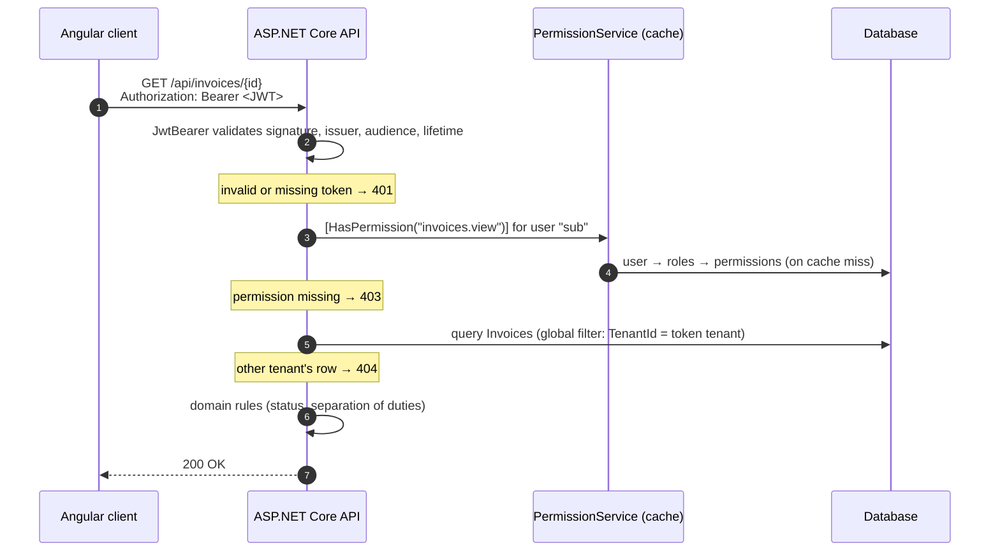

# Authorization & RBAC Reference — ASP.NET Core 10 + Angular

A complete, runnable reference for **role-based access control (RBAC)** with **roles, permissions and claims** in a multi-tenant web application.

The backend is an ASP.NET Core 10 Web API with ASP.NET Core Identity, JWT access tokens, rotating refresh tokens, EF Core 10 and SignalR. The frontend is an Angular 22 standalone application with guards, a permission directive and an HTTP interceptor.

The code is small enough to read in an afternoon. Every authorization decision is explicit and covered by tests.

---

## Contents

- [What this project shows](#what-this-project-shows)
- [The core idea](#the-core-idea)
- [Tech stack](#tech-stack)
- [Getting started](#getting-started)
- [Demo accounts](#demo-accounts)
- [Try these scenarios](#try-these-scenarios)
- [Project structure](#project-structure)
- [How a request is authorized](#how-a-request-is-authorized)
- [API endpoints](#api-endpoints)
- [Testing](#testing)
- [Configuration](#configuration)
- [Going to production](#going-to-production)
- [Further documentation](#further-documentation)
- [License](#license)

---

## What this project shows

| Topic | Where to look |
|---|---|
| Authentication vs. authorization (401 vs. 403) | `Authorization/PermissionAuthorizationFilter.cs` |
| Permission catalogue defined in code | `Authorization/Permissions.cs` |
| Roles as data: users → roles → permissions | `Domain/ApplicationRole.cs`, `Domain/RolePermission.cs` |
| Claims in a JWT, read through `ICurrentUser` | `Authentication/TokenService.cs`, `Authorization/CurrentUser.cs` |
| `[HasPermission]` attribute (no policy-based authorization) | `Authorization/HasPermissionAttribute.cs` |
| Permissions resolved on the server, cached, invalidated on change | `Authorization/PermissionService.cs` |
| Tenant isolation with EF Core global query filters | `Data/AppDbContext.cs` |
| Separation of duties (creator can't approve) | `Domain/Invoice.cs` |
| Privilege-escalation protection | `Authorization/PrivilegeEscalationGuard.cs` |
| Refresh token rotation and reuse detection | `Features/Auth/AuthService.cs` |
| Real-time "your permissions changed" over SignalR | `Realtime/` and `client/src/app/core/realtime/` |
| Angular route guards, `*appHasPermission`, interceptor | `client/src/app/core/auth/` |
| "Every endpoint declares its authorization" test | `tests/Rbac.UnitTests/Architecture/EndpointProtectionTests.cs` |

## The core idea

> **Roles are for people. Permissions are for code.**

- **Developers** define **permissions** in code: small, stable actions such as `invoices.approve`.
- **Administrators** define **roles** at runtime: named sets of permissions such as *Approver*.
- **Code checks permissions only**, never role names.

```csharp
[HttpPost("{id:guid}/approve")]
[HasPermission(Permissions.Invoices.Approve)]
public async Task<ActionResult<InvoiceResponse>> Approve(Guid id, CancellationToken cancellationToken) => ...
```

A new role such as "Night shift approver" needs no code change and no deployment.

## Tech stack

| Layer | Technology |
|---|---|
| API | ASP.NET Core 10, controllers, ProblemDetails (RFC 9457), rate limiting, OpenAPI |
| Identity | ASP.NET Core Identity (`AddIdentityCore`) with `Guid` keys |
| Tokens | JWT access tokens (15 min, HMAC-SHA256) and rotating refresh tokens in an HttpOnly cookie |
| Data | EF Core 10, SQLite (zero setup; SQL Server is a one-line change) |
| Real-time | SignalR |
| Client | Angular 22 (standalone, zoneless, signals and RxJS), Tailwind CSS 4 |
| Tests | xUnit, `WebApplicationFactory` integration tests, Vitest for Angular |

## Getting started

### Prerequisites

- [.NET 10 SDK](https://dotnet.microsoft.com/download)
- [Node.js 24 LTS](https://nodejs.org/)

### 1. Run the API

```bash
cd server
dotnet run --project src/Rbac.Api
```

The API starts on `http://localhost:5080`. In Development it creates `rbac.db` and seeds demo data on first start. To start again from a clean state, delete the `rbac.db` file.

### 2. Run the client

```bash
cd client
npm install
npm start
```

Open `http://localhost:4200`. The Angular dev server forwards `/api` and `/hubs` to the API (`proxy.conf.json`). Because of this, the browser sees one origin, and the refresh cookie works without extra CORS setup.

### 3. Explore the API directly (optional)

Open `server/src/Rbac.Api/Rbac.Api.http` in Visual Studio or VS Code (REST Client) and run the requests. The OpenAPI document is at `http://localhost:5080/openapi/v1.json` in Development.

## Demo accounts

Every account uses the password **`Passw0rd!`**. These accounts exist for local development only.

| Email | Tenant | Roles | Can do |
|---|---|---|---|
| `admin@contoso.test` | Contoso | Administrator (system) | Everything, including users and roles |
| `accountant@contoso.test` | Contoso | Accountant | Create, edit, submit, delete drafts, export |
| `approver@contoso.test` | Contoso | Approver | View, approve and reject submitted invoices |
| `lead@contoso.test` | Contoso | Accountant + Approver | Both, but can't approve **their own** invoices |
| `viewer@contoso.test` | Contoso | Viewer | Read-only |
| `accountant@fabrikam.test` | Fabrikam | Accountant | Same as above, but only sees Fabrikam data |
| `admin@fabrikam.test` | Fabrikam | Administrator (system) | Everything in Fabrikam |

## Try these scenarios

1. **Hidden vs. forbidden.** Sign in as `viewer@contoso.test`. The "New draft" form and the action buttons are hidden. Call `POST /api/invoices` with the viewer's token anyway: the API returns **403**. Hiding UI is only for usability, and the API is the real gate.
2. **Separation of duties.** Sign in as `lead@contoso.test`, create a draft and submit it. The Approve button is disabled. Calling the API directly returns **403**: *"You can't review an invoice you created."*
3. **Tenant isolation.** Copy an invoice id while signed in as `accountant@fabrikam.test`. Request it as a Contoso user: **404**, not 403, so the API doesn't even confirm that the record exists.
4. **Live permission change.** Open two browsers. In one, sign in as `viewer@contoso.test`. In the other, sign in as `admin@contoso.test`, open **Roles → Viewer** and untick `invoices.view`. The viewer's menu updates at once (SignalR), and the viewer's next API call returns 403, without signing in again.
5. **No privilege escalation.** Give a user a role that only has `roles.manage`. They can create roles, but only with permissions they already hold.
6. **Stolen refresh token.** Reuse an old refresh token after it was rotated: the API revokes every session of that user.

## Project structure

```text
.
├── server/
│   ├── Rbac.slnx
│   ├── Directory.Build.props        # shared build settings (net10.0, nullable, ...)
│   ├── Directory.Packages.props     # central NuGet versions
│   ├── src/Rbac.Api/
│   │   ├── Authentication/          # JWT options, token service, JwtBearer setup
│   │   ├── Authorization/           # Permissions catalogue, [HasPermission], filter,
│   │   │                            # permission service, ICurrentUser, escalation guard
│   │   ├── Common/                  # Result pattern, ProblemDetails mapping
│   │   ├── Data/                    # AppDbContext, EF configurations, seeder
│   │   ├── Domain/                  # Tenant, ApplicationUser, ApplicationRole,
│   │   │                            # Permission, RolePermission, RefreshToken, Invoice
│   │   ├── Features/                # Auth, Me, Invoices, Roles, Users, PermissionCatalog
│   │   ├── Realtime/                # SignalR hub and change notifier
│   │   └── Program.cs
│   └── tests/
│       ├── Rbac.UnitTests/          # filter, domain rules, token, catalogue, architecture
│       └── Rbac.IntegrationTests/   # 401 / 403 / 404, SoD, escalation, refresh rotation
├── client/
│   └── src/app/
│       ├── core/auth/               # AuthService, TokenStore, interceptor, guards,
│       │                            # *appHasPermission, permissions.ts
│       ├── core/realtime/           # SignalR client
│       ├── layout/                  # app shell with permission-aware navigation
│       └── features/                # login, home, invoices, users, roles, errors
└── docs/
    ├── architecture.md
    └── authorization-model.md
```

## How a request is authorized



There are four layers. Each one answers a different question:

| Layer | Question | Implementation |
|---|---|---|
| 1. Authentication | Is the token valid? | JwtBearer middleware |
| 2. Permission (RBAC) | May this user do this kind of action? | `[HasPermission]` → `PermissionAuthorizationFilter` |
| 3. Data scope | Is this row in the user's tenant? | EF Core global query filter |
| 4. Business rule | Is this action allowed on this record? | Domain methods such as `Invoice.Approve` |

## API endpoints

| Method | Route | Requires |
|---|---|---|
| POST | `/api/auth/login` · `/refresh` · `/logout` | Anonymous (rate limited) |
| GET | `/api/me` | Signed in |
| GET | `/api/invoices`, `/api/invoices/{id}` | `invoices.view` |
| POST | `/api/invoices` | `invoices.create` |
| PUT | `/api/invoices/{id}` | `invoices.edit` |
| DELETE | `/api/invoices/{id}` | `invoices.delete` |
| POST | `/api/invoices/{id}/submit` | `invoices.submit` |
| POST | `/api/invoices/{id}/approve` · `/reject` | `invoices.approve` |
| GET | `/api/invoices/export` | `invoices.view` **and** `invoices.export` |
| GET | `/api/users`, `/api/users/{id}` | `users.view` |
| POST | `/api/users` | `users.manage` |
| PUT | `/api/users/{id}/roles` | `users.manage` |
| POST | `/api/users/{id}/activate` · `/deactivate` | `users.manage` |
| GET | `/api/roles`, `/api/roles/{id}`, `/api/permissions` | `roles.view` |
| POST / PUT / DELETE | `/api/roles`, `/api/roles/{id}` | `roles.manage` |
| WS | `/hubs/notifications` | Signed in |

Errors are returned as RFC 9457 problem details with messages that are safe to show to users, for example:

```json
{
  "status": 409,
  "title": "Conflict",
  "detail": "A role named 'Viewer' already exists. Choose a different role name."
}
```

## Testing

```bash
# API: unit and integration tests
cd server
dotnet test

# Client: unit tests (Vitest)
cd client
npm test -- --watch=false
```

The integration tests start the real API in memory with its own SQLite database and check:

- 401 without a token, 403 without the permission, 404 for another tenant's data
- AND semantics of two `[HasPermission]` attributes (export)
- separation of duties and privilege-escalation protection
- immediate effect of removing a permission or deactivating a user
- refresh token rotation, reuse detection and cookie flags

`EndpointProtectionTests` fails the build when a new endpoint has none of `[HasPermission]`, `[AuthenticatedOnly]` or `[AllowAnonymous]`.

## Configuration

Settings live in `server/src/Rbac.Api/appsettings.json`:

| Key | Purpose | Default |
|---|---|---|
| `ConnectionStrings:Default` | SQLite connection string | `Data Source=rbac.db` |
| `Database:SeedOnStartup` | Create the database and demo data | `false` (`true` in Development) |
| `Jwt:Issuer`, `Jwt:Audience` | Token validation | `rbac-reference-api`, `rbac-reference-client` |
| `Jwt:SigningKey` | HMAC key, at least 32 bytes | Development key only |
| `Jwt:AccessTokenLifetimeMinutes` | Access token lifetime | `15` |
| `Jwt:RefreshTokenLifetimeDays` | Refresh token lifetime | `7` |
| `Cors:AllowedOrigins` | Origins allowed to call the API | `http://localhost:4200` |
| `RateLimiting:AuthenticationPermitLimit` | Sign-in requests per minute per IP | `10` |

Set the signing key outside source control:

```bash
cd server/src/Rbac.Api
dotnet user-secrets set "Jwt:SigningKey" "<a random value of at least 32 bytes>"
```

## Going to production

This is a reference project. Before you use these ideas in production:

- **Migrations:** replace `EnsureCreated` with EF Core migrations (`dotnet ef migrations add Initial`).
- **Database:** switch to SQL Server or PostgreSQL. SQLite stores `decimal` as text, so don't sort or sum money in SQLite queries.
- **Secrets:** keep `Jwt:SigningKey` in a vault. With many services, consider RS256 so that only the identity service holds the private key.
- **Multiple instances:** move the permission cache to a distributed cache (Redis) and use a SignalR backplane, so that cache invalidation and notifications reach every instance.
- **Reverse proxy:** configure `UseForwardedHeaders` so that rate limiting sees real client IPs.
- **Identity role APIs:** roles are unique **per tenant**. Don't use the name-based Identity APIs (`AddToRoleAsync`, `IsInRoleAsync`, `RoleManager.FindByNameAsync`). They look up roles by name across all tenants. This project manages role links by id.
- **Audit:** log who changed which role or assignment, and when.

## Further documentation

- [docs/architecture.md](docs/architecture.md): components, folders and request pipeline
- [docs/authorization-model.md](docs/authorization-model.md): permissions, roles, claims, design decisions and how to add a new permission

## License

[MIT](LICENSE)
