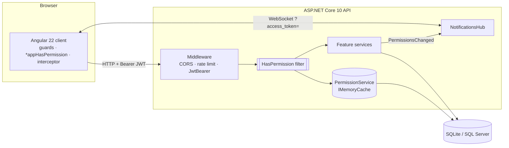
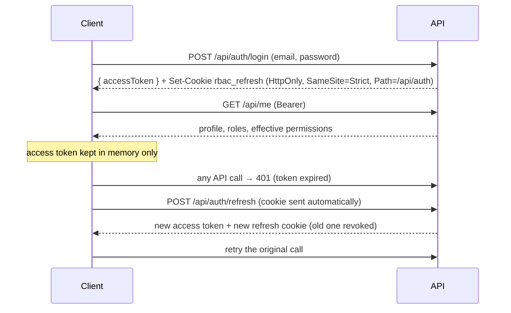

# Architecture

## Components

## Request pipeline

`Program.cs` registers the middleware in this order. **The order matters.**

1. `UseExceptionHandler` / `UseStatusCodePages`: every error becomes RFC 9457 problem details.
2. `UseRouting`: selects the endpoint, so later middleware can read its metadata.
3. `UseCors("Client")`: allows the Angular origin.
4. `UseRateLimiter`: limits sign-in and refresh per IP.
5. `UseAuthentication`: validates the JWT and fills `HttpContext.User`.
6. `UseAuthorization`: applies `[Authorize]` / `[AllowAnonymous]`.
7. `MapControllers`: MVC filters run here, including `PermissionAuthorizationFilter`.

If `UseAuthorization` runs before `UseAuthentication`, every request looks anonymous.

## Folder responsibilities (API)

| Folder | Responsibility | Depends on |
|---|---|---|
| `Domain` | Entities and business rules (no ASP.NET dependencies, except the Identity base classes) | `Common` |
| `Common` | `Result` / `Error`, mapping to problem details | — |
| `Data` | `AppDbContext`, entity configuration, tenant query filters, seeding | `Domain`, `Authorization.ICurrentUser` |
| `Authentication` | Issuing and validating tokens | `Domain` |
| `Authorization` | Permission catalogue, attribute and filter, permission service, current user | `Data` |
| `Features/*` | One folder per use case area: controller, service, contracts | all of the above |
| `Realtime` | SignalR hub and the notifier used after permission changes | `Authorization` |

The project is a single API assembly organized by **feature folders**. This keeps the authorization code easy to follow. In a larger system you can split `Domain`, `Application` and `Infrastructure` into separate projects without changing the ideas.

## Folder responsibilities (client)

| Folder | Responsibility |
|---|---|
| `core/auth` | `AuthService` (session as RxJS streams and signals), `TokenStore` (in-memory token), `authInterceptor`, `authGuard` / `guestGuard` / `permissionGuard`, `HasPermissionDirective`, `permissions.ts` |
| `core/http` | Converts problem details into user messages |
| `core/realtime` | SignalR connection that reloads permissions on `PermissionsChanged` |
| `layout` | Shell with permission-aware navigation |
| `features` | Pages: login, home, invoices, users, roles, errors |

## Session lifecycle

After a page reload the in-memory token is gone. `provideAppInitializer` calls `/api/auth/refresh` once to restore the session before the first route is checked.
